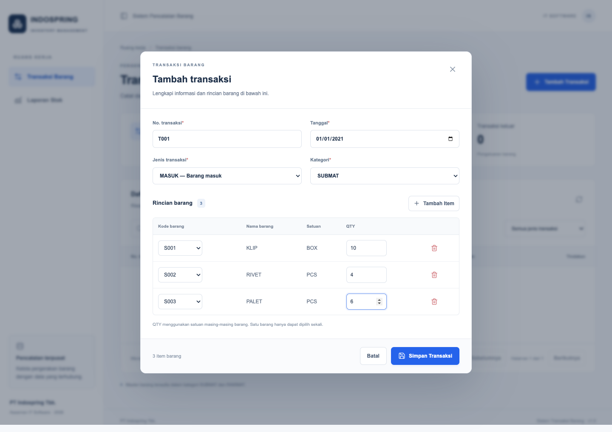
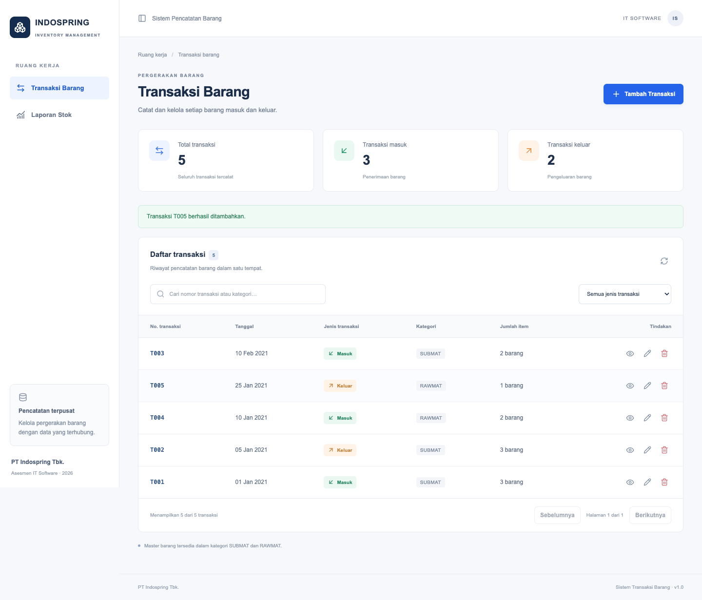
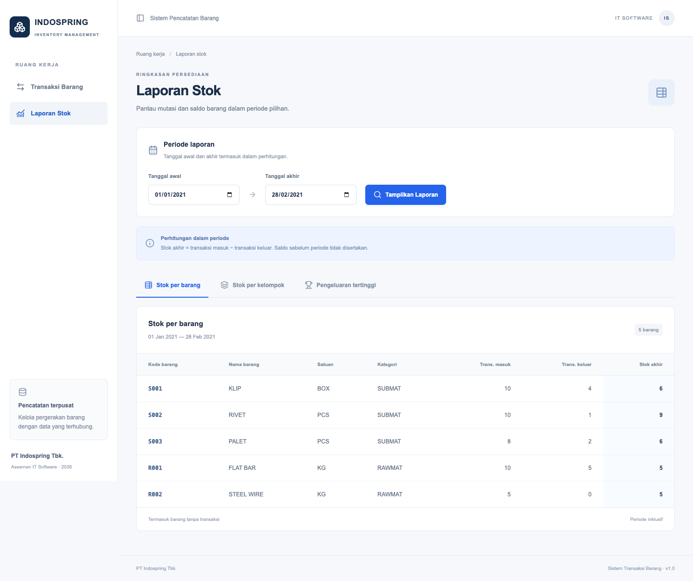
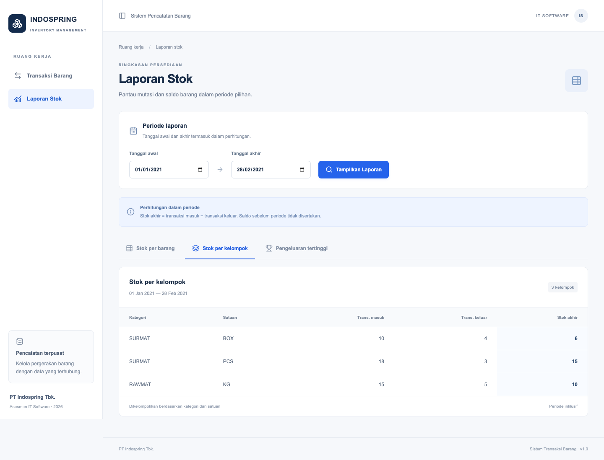
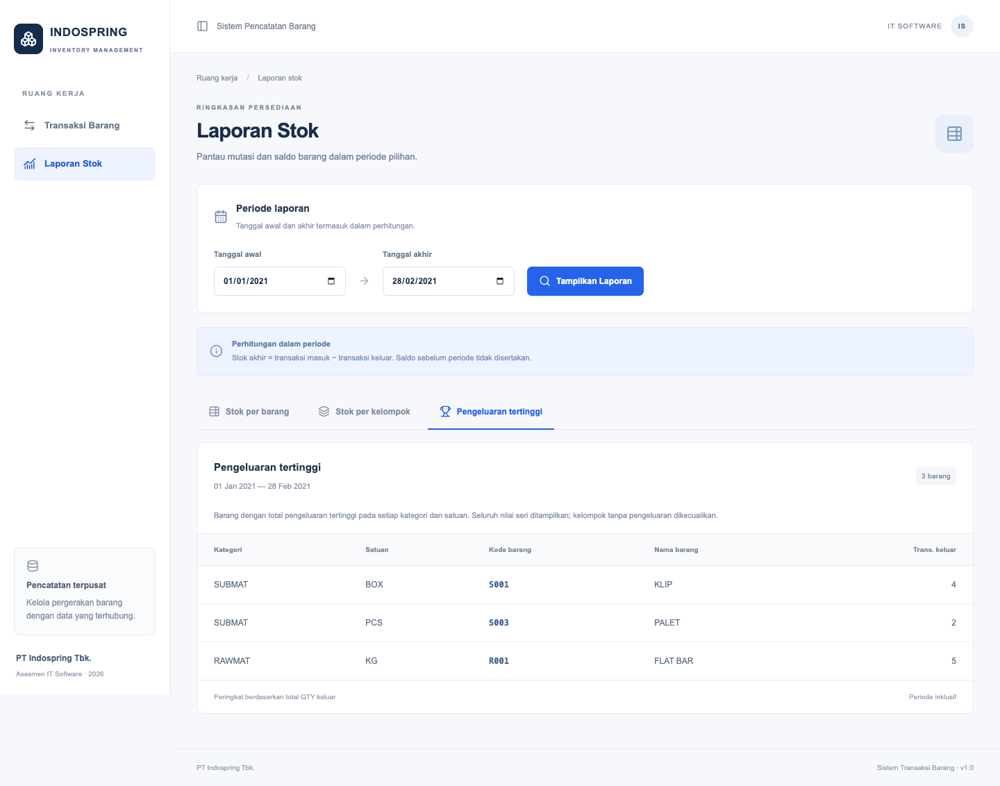

# Pencatatan Transaksi Barang — PT Indospring Tbk.

Aplikasi asesmen IT Software untuk mencatat barang masuk/keluar dan menghasilkan tiga laporan stok sesuai soal. Antarmuka bahasa Indonesia, responsif, satu proyek untuk frontend dan backend.

## Stack

- Next.js 16 App Router, React 19, TypeScript, Tailwind CSS 4.
- Route Handlers Next.js, PostgreSQL, Prisma ORM 6.19.
- Zod untuk validasi bersama frontend/backend; Playwright untuk pengujian browser.
- Versi dependensi yang diuji dikunci di `package-lock.json`. Gunakan `npm ci`.

## Menjalankan dari clone baru

Prasyarat: **Node.js 22.12+ (disarankan Node.js 24 LTS)**, npm, dan **PostgreSQL 16+** yang sudah berjalan. Buat database kosong bernama `indospring` menggunakan pgAdmin atau `createdb indospring` dengan akun PostgreSQL Anda.

```bash
git clone https://github.com/AfifSatrio/Asesmen-Internship-PT-Indospring-Tbk..git
cd Asesmen-Internship-PT-Indospring-Tbk.
npm ci
cp .env.example .env
```

Edit `DATABASE_URL` di `.env` sesuai host, port, nama database, pengguna, dan password lokal. URL-encode karakter khusus pada password. Jangan commit `.env`.

```bash
npm run db:generate
npm run db:setup
npm run dev
```

Buka **http://localhost:3000**. Database awal berisi lima master barang dan **tidak berisi transaksi**. Masukkan transaksi melalui tombol **Tambah Transaksi**.

**Alur setup resmi hanya `npm run db:setup`**, yang menjalankan `sql/schema.sql` lalu `sql/master-data.sql`. Jalankan sekali pada database kosong. Tidak perlu menjalankan `prisma migrate`, `prisma db push`, atau membuat tabel manual lagi. SQL dipilih agar constraint CHECK tetap terpasang; Prisma memetakan tabel tersebut untuk akses data. Master barang diisi langsung dengan SQL; tidak ada CRUD master barang.

Jika tabel sudah ada, jangan ulangi setup. Untuk mengulang pengujian, buat database kosong baru dan arahkan `.env` ke database tersebut. Kesalahan `relation already exists` berarti setup telah pernah dilakukan.

Produksi lokal:

```bash
npm run build
npm start
```

Build memakai Webpack untuk kompatibilitas lingkungan yang membatasi proses/port internal Turbopack. Build tidak memerlukan database aktif; penggunaan aplikasi memerlukannya.

## Fitur

- Daftar, pencarian nomor/kategori, filter jenis, detail, tambah, koreksi, dan hapus transaksi.
- Nomor manual maksimal lima karakter; tidak berubah ketika koreksi.
- Item dipilih berdasarkan kategori header; nama/satuan otomatis; konfirmasi sebelum perubahan kategori mengosongkan item.
- Validasi tanggal kalender, field wajib, minimal satu item, nomor unik, barang terdaftar dan sesuai kategori, tidak ada duplikasi barang, QTY integer 1–2.147.483.647.
- Simpan header dan seluruh detail secara atomik; koreksi memakai isolasi Serializable. Hapus header menghapus detail melalui foreign key CASCADE dalam transaksi database.
- Konfirmasi hapus, status proses, pencegahan submit berulang, pesan berhasil/gagal.
- Tiga laporan dengan filter tanggal, default 1 Januari–28 Februari 2021. Agregasi dilakukan di PostgreSQL, parameter tanggal diikat lewat `Prisma.sql`/`$queryRaw`. Ketiga query dibaca dalam snapshot Repeatable Read.

## Database dan SQL

| Tabel | Kunci | Isi |
| --- | --- | --- |
| `MSBARANG` | `KODE_BARANG` | Master barang |
| `TRMUTASIHD` | `NO_TRANSAKSI` | Header transaksi |
| `TRMUTASIDT` | `(NO_TRANSAKSI, KODE_BARANG)` | Detail barang dan QTY |

Nama tabel/kolom uppercase sesuai soal dan harus dikutip dengan `"` di PostgreSQL. Tipe varchar, integer, dan date mengikuti soal. `prisma/schema.prisma` menggunakan `@map`/`@@map`. Constraint CHECK jenis transaksi, kategori, dan QTY ada pada `sql/schema.sql`; Prisma tidak merepresentasikan CHECK. Konsistensi kategori header/detail dan minimal satu item divalidasi oleh API dalam transaksi database.

Jawaban SQL mandiri nomor **3.1, 3.2, 3.3** ada di [`sql/reports.sql`](sql/reports.sql), dapat dijalankan langsung di query editor PostgreSQL. Query aplikasi ada di `lib/reports.ts`.

## Memasukkan contoh soal

Masukkan lima transaksi ini **melalui form**:

| Nomor | Tanggal | Jenis | Kategori | Item (QTY) |
| --- | --- | --- | --- | --- |
| T001 | 2021-01-01 | MASUK | SUBMAT | S001 (10), S002 (4), S003 (6) |
| T002 | 2021-01-05 | KELUAR | SUBMAT | S001 (4), S002 (1), S003 (2) |
| T003 | 2021-02-10 | MASUK | SUBMAT | S002 (6), S003 (2) |
| T004 | 2021-01-10 | MASUK | RAWMAT | R001 (10), R002 (5) |
| T005 | 2021-01-25 | KELUAR | RAWMAT | R001 (5) |

Hasil periode 2021-01-01 sampai 2021-02-28:

| Kode | Masuk | Keluar | Stok akhir |
| --- | ---: | ---: | ---: |
| S001 | 10 | 4 | 6 |
| S002 | 10 | 1 | 9 |
| S003 | 8 | 2 | 6 |
| R001 | 10 | 5 | 5 |
| R002 | 5 | 0 | 5 |

Kelompok: SUBMAT–BOX = **6**, SUBMAT–PCS = **15**, RAWMAT–KG = **10**. Pengeluaran tertinggi: S001 = **4**, S003 = **2**, R001 = **5**.

## Pengujian

```bash
npm test
npm run typecheck
npm run build
```

Pengujian browser memakai **Google Chrome** terpasang. Untuk Chromium Playwright, ubah `launchOptions.channel` di `playwright.config.ts` dan pasang browser dengan `npx playwright install chromium`.

Gunakan **database pengujian terpisah yang hanya berisi master barang**, jalankan setup di sana dan mulai aplikasi. Tes menolak berjalan bila transaksi sudah ada; tes tidak menghapus data yang sudah ada. Setelah lulus, kelima transaksi contoh tetap tersimpan.

```bash
# Terminal 1 — .env mengarah ke database pengujian kosong yang sudah di-setup
npm run dev

# Terminal 2 — macOS/Linux
E2E_ALLOW_WRITE=1 npm run test:e2e
# PowerShell: $env:E2E_ALLOW_WRITE="1"; npm run test:e2e
```

`TEST_BASE_URL` opsional, default `http://127.0.0.1:3000`. Tes memasukkan contoh melalui form, memeriksa hasil ketiga laporan, koreksi/hapus/detail, penolakan input invalid dan nomor ganda, periode kosong/inklusif, nilai tertinggi seri, dan tampilan mobile. Screenshot tersimpan di `docs/screenshots/`.

## Asumsi dan batasan

- `STOK_AKHIR` = masuk − keluar **hanya dalam periode**, tanpa saldo sebelum periode, sesuai contoh soal.
- Kedua batas tanggal inklusif. Tanggal transaksi adalah tanggal kalender (database `date`), ditampilkan tanpa pergeseran zona waktu.
- Semua barang muncul pada laporan pertama, termasuk yang bernilai nol. Laporan tertinggi menjumlahkan pengeluaran per barang, menampilkan semua yang seri, dan mengecualikan kelompok tanpa pengeluaran.
- Kuantitas agregat dikirim API sebagai string desimal untuk menjaga presisi integer besar; UI memformat dengan `BigInt`.
- Stok negatif belum ditolak, sesuai lingkup wajib. Tidak ada login, pengguna, ekspor, grafik, atau deployment. Jalankan pada lingkungan lokal/tepercaya; API tidak memiliki autentikasi.
- Nomor peka huruf besar/kecil, hanya huruf ASCII, angka, `_`, `-`; maksimal lima karakter. Koreksi bersamaan dapat menghasilkan konflik 409; muat ulang lalu coba kembali. Tidak ada histori revisi/versioning.
- Daftar transaksi dimuat penuh; pagination merupakan pengembangan untuk volume besar.

## Struktur proyek

```text
app/                 Halaman dan Route Handlers /api
components/          Shell navigasi
lib/                 Prisma, validasi, penyimpanan, SQL laporan
prisma/schema.prisma Mapping ORM ke tabel soal
sql/                 Schema, master data, jawaban SQL laporan
tests/               Unit test dan pengujian end-to-end
docs/screenshots/    Bukti tampilan dari pengujian browser
```

## Screenshot







Referensi implementasi: [Next.js Route Handlers](https://nextjs.org/docs/app/getting-started/route-handlers), [Prisma 6 Transactions](https://www.prisma.io/docs/orm/v6/prisma-client/queries/transactions).
