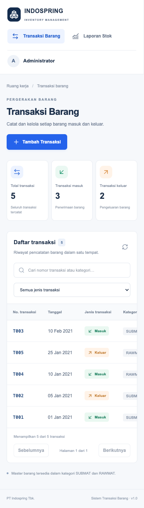

# Pencatatan Transaksi Barang — PT Indospring Tbk.

Aplikasi asesmen IT Software untuk mencatat barang masuk/keluar dan menghasilkan tiga laporan stok sesuai soal. Antarmuka bahasa Indonesia, responsif, satu proyek untuk frontend dan backend.

## Stack

- Next.js 16 App Router, React 19, TypeScript, Tailwind CSS 4.
- Route Handlers Next.js, PostgreSQL, Prisma ORM 6.19.
- Zod untuk validasi bersama frontend/backend; Playwright untuk pengujian browser.
- Versi dependensi yang diuji dikunci di `package-lock.json`. Gunakan `npm ci`.

## Menjalankan dari clone baru

Prasyarat: **Node.js 22.12+**, npm, dan **PostgreSQL 16+** yang sudah berjalan. Buat database kosong bernama `indospring` menggunakan pgAdmin atau `createdb indospring` dengan akun PostgreSQL Anda.

```bash
git clone https://github.com/AfifSatrio/Asesmen-Internship-PT-Indospring-Tbk..git indospring-inventory
cd indospring-inventory
npm ci
cp .env.example .env
```

Edit `DATABASE_URL` di `.env` sesuai host, port, nama database, pengguna, dan password lokal. URL-encode karakter khusus pada password. Jangan commit `.env`.

```bash
npm run db:generate
npm run db:setup
npm run dev
```

Buka **http://localhost:3000**. Database awal berisi lima master barang dan **tidak berisi transaksi**. Masukkan transaksi melalui tombol **Tambah Transaksi**.

**Alur setup resmi hanya `npm run db:setup`**, yang menjalankan `sql/schema.sql` lalu `sql/master-data.sql`. Jalankan sekali pada database kosong. Tidak perlu menjalankan `prisma migrate`, `prisma db push`, atau membuat tabel manual lagi. SQL dipilih agar constraint CHECK tetap terpasang; Prisma memetakan tabel tersebut untuk akses data. Master barang diisi langsung dengan SQL; tidak ada CRUD master barang.

Jika tabel sudah ada, jangan ulangi setup. Untuk mengulang pengujian, buat database kosong baru dan arahkan `.env` ke database tersebut. Kesalahan `relation already exists` berarti setup telah pernah dilakukan.

Produksi lokal:

```bash
npm run build
npm start
```

Build memakai Webpack untuk kompatibilitas lingkungan yang membatasi proses/port internal Turbopack. Build tidak memerlukan database aktif; penggunaan aplikasi memerlukannya.

## Jika database gagal diakses

`npm run dev` menjalankan web server; koneksi tetap membutuhkan server PostgreSQL yang aktif. Periksa host/port di `DATABASE_URL`, layanan PostgreSQL, dan apakah setup tabel sudah dijalankan. Jangan ulangi `db:setup` pada database yang sudah berisi tabel/data.

Pada workspace pengembangan yang memiliki cluster lokal `.local/pgdata` dan runtime `.local/pg-runtime`, `npm run dev` serta `npm start` sekarang otomatis menyalakan kembali cluster tersebut apabila `.env` mengarah ke `127.0.0.1:55432`. Proses ini tidak membuat ulang database, mengganti password, atau menghapus transaksi. Database berjalan di latar belakang dan dapat dikelola dengan:

```bash
npm run db:local:start
npm run db:local:stop
```

Folder `.local` tidak disertakan Git. Pada clone baru, tetap gunakan instalasi PostgreSQL dan alur setup resmi di atas; startup otomatis tidak mengelola PostgreSQL eksternal. Jika komputer di-restart, jalankan kembali `npm run dev` untuk menyalakan cluster lokal yang sudah ada.

## Tampilan dan alur penggunaan

- Navigasi **Transaksi Barang** (`/`) dan **Laporan Stok** (`/laporan`) tersedia melalui sidebar. Tidak ada topbar terpisah.
- Avatar dan label **Administrator** berada di bawah panel **Pencatatan terpusat** pada sidebar desktop. Label ini hanya tampilan statis, bukan akun atau sistem hak akses.
- Halaman transaksi menampilkan ringkasan jumlah transaksi, pencarian, filter jenis, dan tabel dengan pagination 20 data per halaman. Ringkasan menghitung seluruh transaksi, tidak mengikuti pencarian/filter daftar.
- Klik **Tambah Transaksi**, isi nomor, tanggal, jenis, dan kategori, lalu tambahkan barang beserta QTY. Nama barang dan satuan terisi otomatis. Detail dan koreksi dibuka melalui aksi pada tabel.
- Menghapus baris barang hanya mengubah isian form; menghapus transaksi dari daftar menghapus header beserta seluruh detail setelah konfirmasi.
- Halaman laporan memiliki filter periode dan tiga tab: **Stok per barang**, **Stok per kelompok**, serta **Pengeluaran tertinggi**.
- Pada layar kecil, navigasi menyesuaikan lebar layar dan tabel dapat digulir horizontal. Loading, keadaan kosong, pesan gagal, dan tombol **Coba lagi** tersedia untuk pengambilan data.

## Fitur

- Daftar, pencarian nomor/kategori, filter jenis, detail, tambah, koreksi, dan hapus transaksi.
- Nomor manual maksimal lima karakter; tidak berubah ketika koreksi.
- Item dipilih berdasarkan kategori header; nama/satuan otomatis; konfirmasi sebelum perubahan kategori mengosongkan item.
- Validasi tanggal kalender, field wajib, minimal satu item, nomor unik, barang terdaftar dan sesuai kategori, tidak ada duplikasi barang, QTY integer 1–2.147.483.647.
- Simpan header dan seluruh detail secara atomik; tambah dan koreksi memakai isolasi Serializable. Hapus header menghapus detail melalui foreign key CASCADE dalam transaksi database.
- Konfirmasi hapus, status proses, pencegahan submit berulang, pesan berhasil/gagal.
- Tiga laporan dengan filter tanggal, default 1 Januari–28 Februari 2021. Agregasi dilakukan di PostgreSQL, parameter tanggal diikat lewat `Prisma.sql`/`$queryRaw`. Ketiga query dibaca dalam snapshot Repeatable Read.

## Database dan SQL

| Tabel        | Kunci                         | Isi                   |
| ------------ | ----------------------------- | --------------------- |
| `MSBARANG`   | `KODE_BARANG`                 | Master barang         |
| `TRMUTASIHD` | `NO_TRANSAKSI`                | Header transaksi      |
| `TRMUTASIDT` | `(NO_TRANSAKSI, KODE_BARANG)` | Detail barang dan QTY |

Nama tabel/kolom uppercase sesuai soal dan harus dikutip dengan `"` di PostgreSQL. Tipe varchar, integer, dan date mengikuti soal. `prisma/schema.prisma` menggunakan `@map`/`@@map`. Constraint CHECK jenis transaksi, kategori, dan QTY ada pada `sql/schema.sql`; Prisma tidak merepresentasikan CHECK. Konsistensi kategori header/detail dan minimal satu item divalidasi oleh API dalam transaksi database.

Jawaban SQL mandiri nomor **3.1, 3.2, 3.3** ada di [`sql/reports.sql`](sql/reports.sql), dapat dijalankan langsung di query editor PostgreSQL. Query aplikasi ada di `lib/reports.ts`.

## API

Semua endpoint berada dalam proyek Next.js yang sama dan mengembalikan JSON dengan `Cache-Control: no-store`.

| Metode | Endpoint | Kegunaan |
| --- | --- | --- |
| GET | `/api/barang` | Membaca master barang untuk form |
| GET | `/api/transaksi?page=1&q=&jenis=` | Daftar transaksi dengan pagination, pencarian, dan filter |
| POST | `/api/transaksi` | Menambah header dan detail transaksi |
| GET | `/api/transaksi/:nomor` | Memuat satu transaksi beserta detail barang |
| PUT | `/api/transaksi/:nomor` | Mengoreksi transaksi dengan nomor tetap |
| DELETE | `/api/transaksi/:nomor` | Menghapus transaksi beserta seluruh detail |
| GET | `/api/laporan?awal=2021-01-01&akhir=2021-02-28` | Menghasilkan ketiga laporan dalam satu respons |

Contoh body POST/PUT:

```json
{
  "nomor": "T001",
  "tanggal": "2021-01-01",
  "jenis": "MASUK",
  "kategori": "SUBMAT",
  "items": [
    { "kode": "S001", "qty": 10 }
  ]
}
```

Tanggal `awal` dan `akhir` laporan wajib berupa tanggal kalender `YYYY-MM-DD`, dengan awal tidak melewati akhir. Respons laporan berisi `barang`, `kelompok`, dan `tertinggi`; angka hasil agregasi berupa string desimal. Respons kesalahan memakai bentuk `{ "error": "Pesan kesalahan" }`, dengan status 400 untuk input tidak valid, 404 untuk transaksi tidak ditemukan, 409 untuk nomor ganda/konflik perubahan, dan 500 untuk kegagalan server. Penambahan berhasil mengembalikan status 201.

## Memasukkan contoh soal

Masukkan lima transaksi ini **melalui form**:

| Nomor | Tanggal    | Jenis  | Kategori | Item (QTY)                    |
| ----- | ---------- | ------ | -------- | ----------------------------- |
| T001  | 2021-01-01 | MASUK  | SUBMAT   | S001 (10), S002 (4), S003 (6) |
| T002  | 2021-01-05 | KELUAR | SUBMAT   | S001 (4), S002 (1), S003 (2)  |
| T003  | 2021-02-10 | MASUK  | SUBMAT   | S002 (6), S003 (2)            |
| T004  | 2021-01-10 | MASUK  | RAWMAT   | R001 (10), R002 (5)           |
| T005  | 2021-01-25 | KELUAR | RAWMAT   | R001 (5)                      |

Hasil periode 2021-01-01 sampai 2021-02-28:

| Kode | Masuk | Keluar | Stok akhir |
| ---- | ----: | -----: | ---------: |
| S001 |    10 |      4 |          6 |
| S002 |    10 |      1 |          9 |
| S003 |     8 |      2 |          6 |
| R001 |    10 |      5 |          5 |
| R002 |     5 |      0 |          5 |

Kelompok: SUBMAT–BOX = **6**, SUBMAT–PCS = **15**, RAWMAT–KG = **10**. Pengeluaran tertinggi: S001 = **4**, S003 = **2**, R001 = **5**.

## Komponen UI

Setiap komponen UI berada dalam file `.tsx` tersendiri langsung di folder `components/`, misalnya `components/sidebar.tsx`, `components/transaction-dialog.tsx`, dan `components/report-table.tsx`. Impor komponen langsung dari file tersebut:

```tsx
import { TransactionDialog } from "@/components/transaction-dialog";
```

Konstanta konfigurasi komponen (navigasi, pilihan form, tab, kolom, dan label laporan) berada di `data/index.ts` dan diimpor melalui `@/data`. Komponen UI tetap berada di file `.tsx` masing-masing. Teks tampilan dan state tetap pada komponen atau hook terkait. Batas input, kategori, dan jenis transaksi bersama didefinisikan di `lib/validation.ts` agar frontend dan backend tetap konsisten.

## Pagination, pemuatan data, dan indeks

- `GET /api/transaksi?page=1&q=T001&jenis=MASUK` mengembalikan `{ items, page, pageSize, total, totalPages, summary }`. Ukuran halaman tetap **20**. Parameter halaman harus integer positif (maksimal 1.000.000), `q` maksimal 50 karakter, `jenis` kosong/MASUK/KELUAR. Parameter tidak dikenal/berulang ditolak. Halaman yang melebihi akhir dinormalisasi ke halaman terakhir, termasuk setelah penghapusan.
- Urutan daftar selalu `TANGGAL DESC, NO_TRANSAKSI ASC`; nomor unik memecahkan urutan tanggal yang sama. Total, daftar, dan ringkasan dibaca dalam transaksi Repeatable Read. Ringkasan global tetap dihitung dari agregasi header, bukan dari 20 baris halaman aktif.
- Respons daftar hanya berisi nomor, tanggal, jenis, kategori, dan jumlah item. `GET /api/transaksi/:nomor` dipanggil saat detail/koreksi dibuka. Master barang dimuat saat form tambah/koreksi memerlukannya, dipakai ulang selama halaman aktif, dan tidak dimuat ulang setelah setiap penyimpanan.
- Pencarian di server memakai debounce 300 ms. Request lama dibatalkan dengan AbortController; penanda urutan juga menjaga agar respons lama tidak mengganti daftar, detail, atau laporan terbaru. Loading, error, keadaan kosong, dan retry tersedia. Gagal menyimpan tetap mempertahankan seluruh input.
- Setelah mutasi berhasil, halaman daftar aktif dan ringkasan dimuat ulang. Laporan diambil ulang saat halaman laporan dibuka; laporan yang masih terpasang juga mendengarkan event perubahan dan pemulihan browser back/forward cache. Request/response transaksi dan laporan memakai `no-store`, tanpa cache hasil transaksi di server.
- Laporan menggunakan SQL parameterized dan menjumlahkan detail hanya dari header dalam periode. Semua master barang tetap muncul melalui LEFT JOIN. Ketiga agregasi laporan dibaca dalam snapshot Repeatable Read, dengan hasil bigint diserialisasi sebagai string.
- Instance Prisma dibagi melalui modul `lib/db.ts` dan global proses, termasuk mode produksi. Route Handler tidak membuat client/koneksi baru atau memanggil disconnect per request.

Untuk **database yang sudah ada**, jalankan sekali (aman diulang):

```bash
npm run db:optimize
```

Perintah ini menjalankan `sql/optimize-index.sql`: membuat indeks `TRMUTASIHD_TANGGAL_NO_TRANSAKSI_idx` pada `(TANGGAL DESC, NO_TRANSAKSI ASC)` lalu menghapus indeks tanggal tunggal lama. Tidak menghapus transaksi. Setup database baru langsung memakai indeks gabungan tersebut. Prefix tanggal mendukung filter periode dan urutan daftar. Primary key detail `(NO_TRANSAKSI, KODE_BARANG)` sudah mendukung join header-detail dan hitungan item, sehingga tidak ditambahkan indeks `NO_TRANSAKSI` yang redundant. Pencarian substring tidak diberi indeks B-tree yang tidak membantu; ekstensi trigram belum diperlukan untuk lingkup ini. EXPLAIN pada lima transaksi contoh dapat memilih sequential scan karena ukuran tabel kecil; keputusan planner tetap berbasis biaya.

## Pengujian

```bash
npm test
npm run typecheck
npm run build
```

Pengujian browser memakai **Google Chrome** terpasang. Untuk Chromium Playwright, ubah `launchOptions.channel` di `playwright.config.ts` dan pasang browser dengan `npx playwright install chromium`.

Gunakan **database pengujian terpisah yang hanya berisi master barang**, jalankan setup di sana dan mulai aplikasi. Skenario contoh soal memeriksa bahwa daftar transaksi awal kosong. Suite menulis dan menghapus fixture miliknya, sehingga harus dijalankan pada database pengujian terpisah. Setelah lulus, kelima transaksi contoh tetap tersimpan; gunakan database pengujian kosong baru untuk mengulang seluruh suite.

```bash
# Terminal 1 — .env mengarah ke database pengujian kosong yang sudah di-setup
npm run dev

# Terminal 2 — macOS/Linux
E2E_ALLOW_WRITE=1 npm run test:e2e
# PowerShell: $env:E2E_ALLOW_WRITE="1"; npm run test:e2e
```

`TEST_BASE_URL` opsional, default `http://127.0.0.1:3000`. Tes memasukkan contoh melalui form, memeriksa hasil ketiga laporan, koreksi/hapus/detail, penolakan input invalid dan nomor ganda, periode kosong/inklusif, nilai tertinggi seri, dan tampilan mobile. Screenshot tersimpan di `docs/screenshots/`.

Pengujian tambahan `tests/performance.spec.ts` mencakup 25 transaksi dengan tanggal sama, pagination/urutan, parameter invalid, request detail/master, debounce/respons terlambat, pemulihan API gagal, pencegahan submit ulang, input yang bertahan saat gagal, pembaruan laporan setelah tambah/koreksi/hapus, dan layout mobile. Jalankan seluruh suite pada database pengujian kosong sesuai petunjuk sebelumnya. Test menambahkan fixture sementara; data kerja tidak digunakan.

Tidak ada konfigurasi atau script lint pada proyek ini. Pemeriksaan yang tersedia adalah `npm run typecheck`, `npm test`, `npm run test:e2e`, dan `npm run build`; tidak ditambahkan dependensi linter baru.

Catatan hasil pemeriksaan sebelumnya tersedia di [`docs/VERIFIKASI.md`](docs/VERIFIKASI.md).

## Asumsi dan batasan

- `STOK_AKHIR` = masuk − keluar **hanya dalam periode**, tanpa saldo sebelum periode, sesuai contoh soal.
- Kedua batas tanggal inklusif. Tanggal transaksi adalah tanggal kalender (database `date`), ditampilkan tanpa pergeseran zona waktu.
- Semua barang muncul pada laporan pertama, termasuk yang bernilai nol. Laporan tertinggi menjumlahkan pengeluaran per barang, menampilkan semua yang seri, dan mengecualikan kelompok tanpa pengeluaran.
- Kuantitas agregat dikirim API sebagai string desimal untuk menjaga presisi integer besar; UI memformat dengan `BigInt`.
- Stok negatif belum ditolak, sesuai lingkup wajib. Tidak ada login, pengguna, ekspor, grafik, atau deployment. Jalankan pada lingkungan lokal/tepercaya; API tidak memiliki autentikasi.
- Nomor peka huruf besar/kecil, hanya huruf ASCII, angka, `_`, `-`; maksimal lima karakter. Koreksi bersamaan dapat menghasilkan konflik 409; muat ulang lalu coba kembali. Tidak ada histori revisi/versioning.
- Daftar transaksi memakai pagination server 20 baris. Offset pagination dipilih untuk lingkup asesmen; pada volume sangat besar, cursor pagination dapat dievaluasi berdasarkan pengukuran.

## Struktur proyek

```text
app/                 Halaman dan Route Handlers /api
components/          Komponen UI terpisah: sidebar, form, tabel, laporan, footer
data/index.ts        Konstanta konfigurasi komponen UI
hooks/               State, request, debounce, dan alur transaksi/laporan
lib/                 Prisma, validasi, penyimpanan, SQL laporan
prisma/schema.prisma Mapping ORM ke tabel soal
sql/                 Schema, master data, optimasi indeks, jawaban SQL laporan
scripts/             Pengelolaan cluster PostgreSQL lokal opsional
tests/               Unit test dan pengujian end-to-end
docs/VERIFIKASI.md   Catatan hasil pengujian sebelumnya
docs/screenshots/    Bukti tampilan dari pengujian browser
```

## Screenshot

Screenshot diperbarui pada 6 November 2026 dari build produksi lokal: UI tanpa topbar, Administrator di bawah panel Pencatatan terpusat pada sidebar desktop, dan tampilan mobile. Data daftar serta laporan memakai lima transaksi contoh soal. Isian T006 pada screenshot form hanya contoh pengisian dan tidak disimpan.



